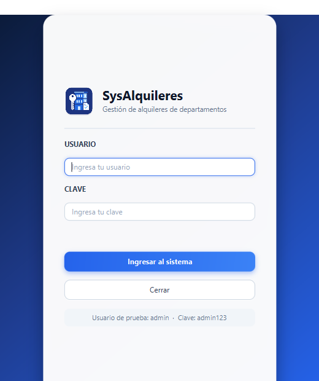
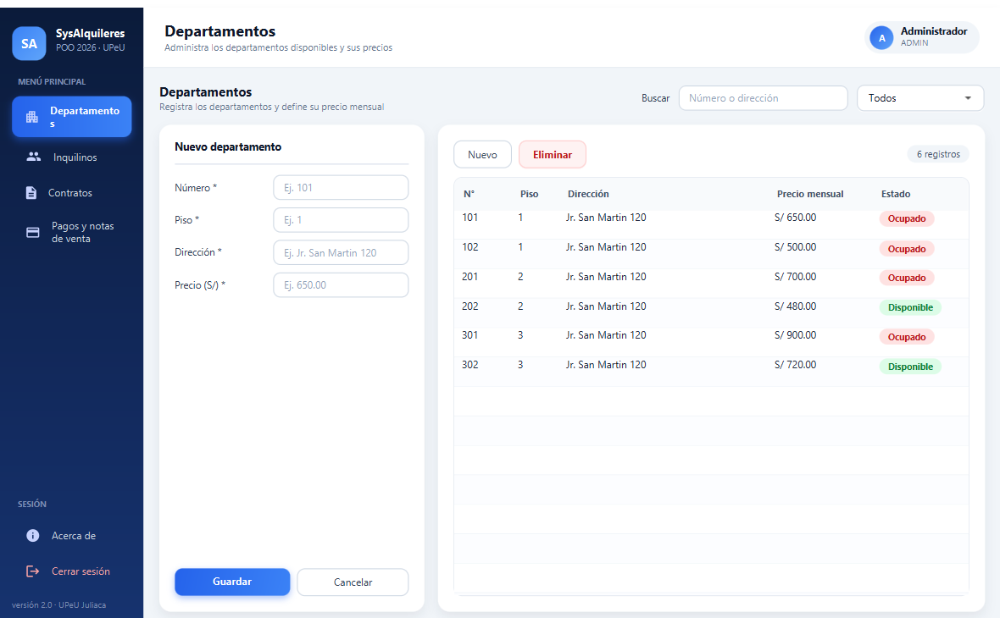

# SysAlquileres · Gestión de Departamentos

Sistema de escritorio para administrar el alquiler de departamentos: departamentos, inquilinos, contratos y pagos. Desarrollado en **Java 21 + JavaFX + FXML** con arquitectura por capas, siguiendo el estilo sencillo del proyecto de referencia del curso **POO 2026 · UPEU Juliaca**.

| Login | Ventana principal |
|---|---|
|  |  |

---

## Documentación

| Documento | Contenido |
|---|---|
| [📘 Manual de usuario (HTML)](docs/MANUAL_USUARIO.html) · [MD](docs/MANUAL_USUARIO.md) | Uso paso a paso del escritorio y del APK |
| [🎤 Guía de exposición (HTML)](docs/GUIA_EXPOSICION.html) · [MD](docs/GUIA_EXPOSICION.md) | Arquitectura, reglas, guion de 12 minutos y preguntas |
| [🧱 Código fuente (HTML)](docs/CODIGO_FUENTE.html) · [MD](docs/CODIGO_FUENTE.md) | Estructura, capas y compilación |
| [⚙️ Configuración (HTML)](docs/CONFIGURACION.html) · [MD](docs/CONFIGURACION.md) | Impresora, base activa, Architect y accesos |
| [🖨️ Impresión 58/80 mm (HTML)](docs/IMPRESION_58MM.html) · [MD](docs/IMPRESION_58MM.md) | Ticket, cable, Bluetooth y ESC/POS |
| [📦 Empaquetamiento (HTML)](docs/EMPAQUETAMIENTO.html) · [MD](docs/EMPAQUETAMIENTO.md) | `.exe`, ZIP portable y APK |
| [☁️ Supabase (HTML)](docs/SUPABASE.html) · [MD](docs/SUPABASE.md) | Variables, conexión y scripts |
| [☁️ Supabase didáctico (HTML)](docs/SUPABASE_EXPLICADO.html) | Diagramas y recorrido del dato |
| [📱 APK de clientes (HTML)](docs/APK_CLIENTES.html) · [MD](docs/APK_CLIENTES.md) | Roles, claves y datos filtrados |
| [🎬 Presentación interactiva](docs/PRESENTACION.html) | 23 diapositivas con simulador, quiz y miniaturas |
| [📄 ENTREGABLES.md](ENTREGABLES.md) | Índice de requisitos del proyecto final |

---

## 1. Funcionalidades

### Login
- Pantalla de acceso al iniciar la aplicación.
- Validación real contra la tabla `usuario` de la base de datos.
- Mensaje de error si el usuario o la clave no son correctos.
- Credenciales de prueba: **admin / admin123**.

### Accesos de clientes (CRUD completo)
- Panel **“Accesos clientes”** en la barra lateral: **alta, lectura, edición y eliminación**.
- Lista de usuarios `CLIENTE` (DNI, nombre, rol, estado y clave); la clave puede ocultarse/mostrarse.
- Botones: **Nuevo cliente**, **Generar clave**, **Guardar clave**, **Eliminar**, **Activar**, **Desactivar** y **Actualizar lista**.
- Al crear un contrato se genera el acceso; si el cliente olvida su clave, se consulta o renueva aquí.
- **Al finalizar un contrato**, la clave del cliente se desactiva automáticamente; **al crear uno nuevo**, se reactiva.
- No requiere la *secret key* de Supabase: el escritorio edita la tabla `usuario` por JDBC.

### Ventana principal
- Barra lateral de navegación con los cuatro módulos y acceso rápido a la sesión.
- Cabecera con el nombre del usuario autenticado y el rol.
- Cada módulo se carga una sola vez y se reutiliza al cambiar de sección.
- Encabezado con el nombre del usuario autenticado y barra de estado con el módulo y la fecha.
- Cada módulo muestra el **formulario a la izquierda** y la **tabla a la derecha**.

### Departamentos
- Listado con búsqueda por número o dirección y filtro por estado.
- Registro y edición desde el formulario; al seleccionar una fila se cargan sus datos.
- Eliminación con confirmación; se bloquea si el departamento tiene contratos asociados.
- Estados: `Disponible` y `Ocupado`. El estado cambia automáticamente al crear o finalizar un contrato.

### Inquilinos
- Búsqueda por DNI, nombre o apellido y filtro por tipo de personería.
- Validación de **DNI único de 8 dígitos numéricos**.
- Personería **Natural** o **Jurídica**; para la jurídica se habilitan representante legal, RUC (10–11 dígitos) y dirección fiscal.
- Eliminación bloqueada si el inquilino tiene contratos.

### Contratos
- Registro de contrato con inquilino, departamento, fechas, monto mensual y cantidad de personas.
- **Regla de negocio:** un departamento no puede tener dos contratos vigentes con fechas superpuestas.
- Validación de fechas: la fecha de fin debe ser posterior a la de inicio.
- Finalización con motivo (`Fin de plazo`, `Rescisión`, `Incumplimiento`, `Mutuo acuerdo`), liberando el departamento y desactivando el acceso del cliente.
- Al crear un contrato nuevo se reactiva el acceso del cliente para la APK.
- No se pueden editar ni eliminar contratos finalizados; tampoco eliminar contratos con pagos.

### Pagos
- Registro de pagos asociados a un contrato, con periodo, método, descuento e IGV.
- Búsqueda por inquilino, departamento o periodo y filtro por método de pago.
- Edición y eliminación con confirmación.
- Métodos: Efectivo, Transferencia, Yape, Plin, Tarjeta.

### Nota de venta (impresión térmica 58/80 mm)
- Al registrar un pago se pregunta si se desea imprimir la nota de venta; también se puede reemitir desde el botón **Nota de venta** del módulo de pagos.
- Vista previa, selección de papel (**58 mm / 32 columnas** u **80 mm / 48 columnas**) y conexión por **Windows (USB/Bluetooth)** o **puerto COM**.
- Incluye datos de la empresa, cliente, departamento, contrato, periodo, importes y total; opción **Copiar texto**.

### Base de datos en la nube (Supabase)
- La aplicación puede trabajar con **Supabase (PostgreSQL)** además de H2 local.
- Script listo para ejecutar: `database/supabase_schema.sql`.
- Guía completa: [`docs/SUPABASE.md`](docs/SUPABASE.md).

---

## 2. Arquitectura

```
src/main/java/pe/edu/upeu/alquileres
├── App.java                     # Punto de entrada: login → ventana principal
├── components/                  # Diálogos,NotaVentaDialog y Celdas (chips de tabla)
├── config/
│   ├── AppContext.java          # Contenedor de dependencias (repos + servicios + controladores)
│   ├── DatabaseConfig.java      # HikariCP, esquema, seed y conexión a Supabase
│   └── ConfigImpresion.java     # Configuración persistente de la impresora térmica
├── controller/                  # Login, principal, módulos, ConfiguracionImpresionController y UsuarioController
├── enums/                       # EstadoDepartamento, EstadoContrato, MetodoPago
├── exception/                   # BusinessException
├── impresion/                   # NotaVenta, ImpresoraWindows e ImpresoraSerial (58 mm)
├── model/                       # Usuario, Departamento, Inquilino, TipoPersoneria, Contrato, Pago...
├── repository/                  # Interfaces + AbstractJpaRepository (JDBC)
├── service/                     # Interfaces + implementaciones con reglas de negocio
└── util/                        # Formato, Sesion y Validador (Jakarta Validation)
```

Flujo de una operación:

```
FXML → Controller → Service (valida reglas) → Repository (JDBC) → Base de datos
```

Las dependencias se crean una sola vez en `AppContext`; los controladores se inyectan con `loader.setControllerFactory(context::getBean)`.

---

## 3. Requisitos

| Herramienta | Versión |
|---|---|
| JDK | 21 |
| Maven | 3.9+ |
| JavaFX | 21.0.6 (se descarga con Maven) |
| Base de datos | H2 embebida (por defecto) o PostgreSQL 14+ |

No es necesario instalar JavaFX ni H2 por separado: Maven resuelve las dependencias.

---

## 4. Ejecución

Desde la carpeta `SysAlquileres`:

```bash
mvn javafx:run
```

En Windows, si `mvn` no está en el PATH:

```powershell
mvn.cmd -B javafx:run
```

También se puede ejecutar desde IntelliJ con el botón verde **Run** sobre `App` o sobre `SysAlquileres`. La clase `App` no extiende `Application` directamente (la ventana JavaFX está en la clase interna `App.Ventana`), justamente para evitar el error *"JavaFX runtime components are missing"*.

Compilar y empaquetar:

```bash
mvn -B -DskipTests package
```

La primera ejecución crea la base en `data/alquileres.mv.db`, ejecuta `schema.sql` y carga `seed.sql`.

Al iniciar aparece el **login**; ingresa con el usuario `admin` y la clave `admin123`.

### Ejecutable .exe (Windows)

El proyecto genera una imagen de aplicación con `jpackage`: un `.exe` que **ya incluye Java y JavaFX**,
por lo que la computadora donde se ejecute no necesita tener JDK instalado.

```powershell
powershell -ExecutionPolicy Bypass -File scripts\build-exe.ps1
```

Resultados:

| Archivo | Uso |
|---|---|
| `dist\SysAlquileres\SysAlquileres.exe` | Ejecutable portable: abre la carpeta y haz doble clic |
| `dist\SysAlquileres-v2.0.0-portable.zip` (~60 MB) | Archivo para entregar; descomprimir y ejecutar el `.exe` |

Notas:

- El ZIP contiene las carpetas `app\`, `runtime\` y el ejecutable; no las separes.
- No es un instalador: es una aplicación portable. Para generar un instalador `.exe`/`.msi`
  con `jpackage --type exe` se necesita instalar **WiX Toolset 3.x**.
- Si se usa Supabase, las variables de entorno deben configurarse en la misma terminal
  desde la que se inicia el `.exe` (o de forma permanente con `setx`).

### APK Android (apoyo informativo · v1.1)

Versión móvil de **solo lectura** que comparte la base de datos de Supabase:

```powershell
cd android
$env:JAVA_HOME="C:\Program Files\Java\jdk-17"   # Gradle 8.11 no compila con GraalVM 21
.\gradlew.bat assembleRelease
```

- APK entregable: `dist\SysAlquileres-Movil-v1.1.apk`
- **Login valida el rol** de la tabla `usuario`:
  - **ADMIN** → ve los listados de los 4 módulos solo para consulta.
  - **CLIENTE** → ve únicamente **su** departamento, contrato, vencimiento e historial de pagos.
- Al crear un contrato en el escritorio se genera automáticamente el usuario cliente (**su DNI**) y una clave aleatoria, que se muestran al administrador para entregarlas.
- Guía completa: [`docs/APK_CLIENTES.md`](docs/APK_CLIENTES.md).

### Credenciales H2 por defecto

| Parámetro | Valor |
|---|---|
| URL | `jdbc:h2:file:./data/alquileres;MODE=PostgreSQL;DATABASE_TO_LOWER=TRUE` |
| Usuario | `sa` |
| Contraseña | *(vacía)* |

Para reiniciar la base de datos: cierra la aplicación y elimina la carpeta `data/`. Al volver a iniciar se recrea con los datos de ejemplo, incluido el usuario `admin`.

> **Base activa en este entorno:** hay variables `SUPABASE_DB_*` configuradas, por lo que el sistema está usando **Supabase / PostgreSQL** (pooler `aws-0-us-east-1.pooler.supabase.com`). `application.properties` sigue trayendo H2 como valor por defecto; las variables de entorno tienen prioridad. Para volver a H2 local, cierra la app y elimina/desactiva esas variables de entorno. La ruta del panel **Config. impresión** muestra el motor activo en tiempo real.

> **Para la exposición / uso comercial:** la versión entregada usa **H2 embebida** por defecto: es gratuita, se crea sola y permite que cada estación funcione sin internet. Si se desea una **base en la nube** (Supabase/PostgreSQL) para compartir datos entre varias PCs o con la APK, ese servicio externo implica un **costo adicional** de hosting y requiere configurar variables de entorno. En un software comercial se usaría una única base centralizada con secretos gestionados, autenticación real y copias de seguridad; en este proyecto académico la arquitectura por capas permite cambiar de base sin tocar la interfaz.

> El modelo **Power Architect** actualizado está en la carpeta **`modelo-power-architect/`**, archivo `SysAlquileres-PowerArchitect.architect` (7 tablas, incluida `usuario`). El original de REQUERIMIENTOS se conserva como `PowerArchitect-Original.architect`. Instrucciones en `modelo-power-architect/README.md`.

> Si actualizas desde una versión anterior, elimina la carpeta `data/` una vez: las bases ya creadas no reciben automáticamente la tabla `usuario`.

---

## 5. Uso con PostgreSQL

1. Crear la base:

   ```sql
   CREATE DATABASE alquileres;
   ```

2. Ejecutar el script incluido:

   ```bash
   psql -U postgres -d alquileres -f database/postgresql_sistema_alquileres.sql
   ```

   El script crea tablas, restricciones (`CHECK`, claves foráneas, exclusión de solapamiento con `btree_gist`), índices, vistas y los datos de ejemplo (incluido el usuario `admin`).

3. Editar `src/main/resources/application.properties`:

   ```properties
   db.url=jdbc:postgresql://localhost:5432/alquileres
   db.username=postgres
   db.password=postgres
   db.ddl.auto=false
   db.seed.demo=false
   ```

4. Ejecutar de nuevo con `mvn javafx:run`.

---

## 6. Modelo de datos

| Tabla | Descripción |
|---|---|
| `usuario` | Usuario, clave, nombre, rol y estado para el login |
| `tipo_personeria` | Natural / Jurídica |
| `departamento` | Número, piso, dirección, precio mensual y estado |
| `inquilino` | DNI único, datos personales y datos de personería jurídica |
| `contrato` | Fechas, monto, estado, inquilino y departamento |
| `pago` | Fecha, periodo, monto, método, descuento e IGV |
| `finalizacion_contrato` | Fecha y motivo de finalización |

Relaciones principales:

```
departamento 1 ─── N contrato N ─── 1 inquilino
                      │
                      1
                      │
                      N
                    pago

usuario (independiente, solo autenticación)
```

Restricciones destacadas:

- `usuario.usuario` único; el login solo acepta usuarios con estado `Activo`.
- `inquilino.dni` único y de 8 dígitos.
- `departamento.numero` único.
- `contrato.fecha_fin > contrato.fecha_inicio`.
- En PostgreSQL, `EXCLUDE USING gist` impide contratos vigentes superpuestos para un mismo departamento.
- `pago.idcontrato` obligatorio: todo pago pertenece a un contrato.

---

## 7. Datos de ejemplo

| Módulo | Registros |
|---|---|
| Usuarios | 1 (`admin` / `admin123`) |
| Departamentos | 6 (101, 102, 201, 202, 301, 302) |
| Inquilinos | 5 |
| Contratos | 5 (4 vigentes, 1 finalizado) |
| Pagos | 8 |

---

## 8. Estructura del proyecto

```
SysAlquileres/
├── database/
│   ├── postgresql_sistema_alquileres.sql
│   ├── supabase_schema.sql                      # Script para Supabase
│   ├── modelo-power-architect.architect         # Modelo actualizado (7 tablas)
│   └── modelo-power-architect-original.architect # Modelo original de REQUERIMIENTOS
├── modelo-power-architect/      # ENTREGABLE: modelo abierto en SQL Power Architect
│   ├── SysAlquileres-PowerArchitect.architect   # actualizado (7 tablas)
│   ├── PowerArchitect-Original.architect
│   └── README.md                # cómo abrirlo y cambios
├── docs/
│   ├── index.html                   # índice de documentación
│   ├── MANUAL_USUARIO.html          # Manual con botón Descargar en PDF
│   ├── MANUAL_USUARIO.md
│   ├── PRESENTACION.html            # Presentación interactiva
│   ├── CONFIGURACION.md             # Panel de impresora y base activa
│   ├── IMPRESION_58MM.md            # Guía de impresión térmica
│   ├── GUIA_EXPOSICION.md
│   ├── SUPABASE.md                  # Guía de conexión a Supabase
│   ├── CODIGO_FUENTE.md
│   ├── EMPAQUETAMIENTO.md
│   ├── assets/                      # SVG de portada e impresora
│   └── screenshots/v2/              # Capturas actuales del sistema
├── scripts/
│   └── build-exe.ps1                # Genera el .exe portable
├── dist/                            # .exe y ZIP (se generan con build-exe.ps1)
├── src/main/java/pe/edu/upeu/alquileres/
├── src/main/resources/
│   ├── application.properties
│   ├── logback.xml
│   ├── schema.sql
│   ├── seed.sql
│   ├── css/app.css
│   └── view/
│       ├── login.fxml
│       ├── main.fxml
│       ├── departamentos.fxml
│       ├── inquilinos.fxml
│       ├── contratos.fxml
│       ├── pagos.fxml
│       ├── configuracion-impresion.fxml
│       └── usuarios.fxml
├── data/                        # Base H2 (se genera al ejecutar)
└── pom.xml
```

---

## 9. Notas

- La aplicación usa H2 en modo PostgreSQL para que funcione sin instalación adicional; el script de PostgreSQL queda disponible para el despliegue descrito en el informe.
- La clave del usuario se guarda en texto plano para mantener el ejemplo académico simple; en un sistema real debe almacenarse con hash (por ejemplo, BCrypt).
- Los formularios validan en el servicio y muestran los errores con `BusinessException` en una etiqueta del formulario, sin cerrar la pantalla.
- Las confirmaciones de eliminación y finalización usan diálogos simples (`Dialogos`).
- El proyecto no usa `module-info.java`; se ejecuta en classpath mediante `javafx-maven-plugin`.
