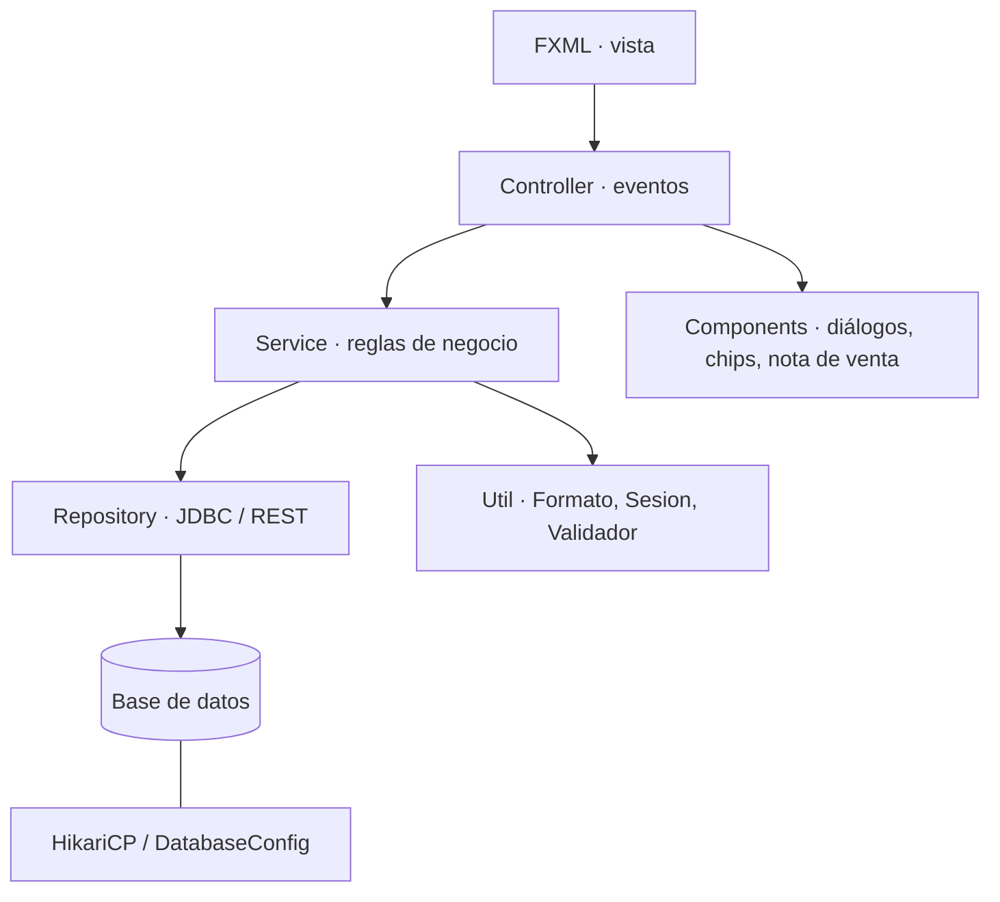
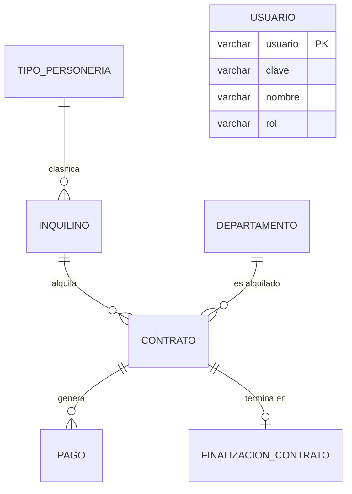

# Guía completa de exposición y explicación del código — SysAlquileres v2.0

> **Cómo usar esta guía**
> - Secciones **1–3**: qué es el sistema y cómo se ejecuta.
> - Sección **4**: arquitectura (lo que más te van a preguntar).
> - Sección **5**: explicación de **todo el código**, clase por clase.
> - Secciones **6–10**: base de datos, Supabase, `.exe` y APK.
> - Sección **11**: guion listo para exponer (12 minutos).
> - Sección **12**: preguntas probables del profesor y respuestas.
>
> No memorices: entiende el **flujo** y las **reglas de negocio**. Si te preguntan por un archivo, busca aquí el nombre y lee el párrafo correspondiente.

---

## 1. ¿Qué es SysAlquileres?

SysAlquileres es una aplicación de **escritorio** (y una versión **móvil** companion) para administrar el alquiler de departamentos. Registra departamentos, inquilinos, contratos y pagos, y aplica reglas que evitan información contradictoria.

**Problema que resuelve:** llevar el alquiler en cuadernos o Excel permite errores como alquilar dos veces el mismo departamento, registrar pagos sin contrato, duplicar inquilinos o poner fechas imposibles. El sistema centraliza los datos y valida esas reglas antes de guardar.

| Módulo | Para qué sirve |
|---|---|
| Login | Identifica al usuario (`admin / admin123`) |
| Departamentos | Número, piso, dirección, precio y estado |
| Inquilinos | Personas naturales (DNI) o empresas (RUC) |
| Contratos | Relaciona inquilino + departamento + fechas |
| Pagos | Pagos mensuales de cada contrato y nota de venta |

**Tecnologías usadas**

| Capa | Tecnología |
|---|---|
| Interfaz | JavaFX 21 + FXML + CSS propio (`app.css`) |
| Lenguaje | Java 21 (records, lambdas, streams) |
| Construcción | Maven 3.9 + JavaFX Maven Plugin |
| Base de datos | H2 (modo PostgreSQL) por defecto · **Supabase PostgreSQL 17** en la nube |
| Pool de conexiones | HikariCP |
| Validación | Jakarta Validation + Hibernate Validator |
| Impresión | `javax.print` + jSerialComm (ticket térmico 58 mm) |
| Utilidades | Lombok, SLF4J + Logback |
| Móvil | Android nativo en Java + Supabase REST (PostgREST) |
| Empaquetado | `jpackage` (JDK 21) → `.exe` portable |

---

## 2. Entregables del proyecto

| Entregable | Ubicación | Observación |
|---|---|---|
| Código fuente | `src/main/java`, `src/main/resources` | Arquitectura por capas |
| Scripts SQL | `database/` | H2/PostgreSQL y **Supabase** |
| Documentación | `docs/` | Esta guía, Supabase, impresión, capturas |
| Ejecutable Windows | `dist/SysAlquileres/SysAlquileres.exe` | Incluye JRE; no requiere Java instalado |
| ZIP portable | `dist/SysAlquileres-v2.0.0-portable.zip` | Para entregar/descargar |
| APK Android | `android/app/build/outputs/apk/release/app-release.apk` | MVP exposable |
| Generadores | `scripts/build-exe.ps1`, `android/gradlew.bat` | Reconstruyen ambos entregables |

> El `.exe` necesita las carpetas `app\` y `runtime\` que están a su lado. Por eso se entrega el ZIP, no el `.exe` suelto.

---

## 3. Cómo ejecutar cada versión

### 3.1 Desde el código (desarrollo)

```powershell
cd "D:\CRUD DEPARTAMENTOS\SysAlquileres"
mvn.cmd -B javafx:run
```

Primera ejecución: se crea la base H2 en `~/SysAlquileres/data/alquileres.mv.db` (carpeta del usuario), se ejecuta `schema.sql` y se cargan los datos de `seed.sql`.

### 3.2 Ejecutable Windows

Descomprimir `SysAlquileres-v2.0.0-portable.zip` y abrir `SysAlquileres.exe`. No necesita JDK ni Maven. Para regenararlo:

```powershell
powershell -ExecutionPolicy Bypass -File scripts\build-exe.ps1
```

### 3.3 APK Android

```powershell
cd android
.\gradlew.bat assembleRelease
```

El APK queda en `android\app\build\outputs\apk\release\app-release.apk`. Para instalarlo:

```powershell
adb install -r "app\build\outputs\apk\release\app-release.apk"
```

---

## 4. Arquitectura por capas



| Capa | Responsabilidad | No debe hacer |
|---|---|---|
| **Vista (FXML + CSS)** | Mostrar controles y diseño | Tener lógica ni SQL |
| **Controller** | Recibir clics, leer campos, llenar tablas | Validar reglas complejas ni escribir SQL |
| **Service** | Validar y aplicar reglas de negocio | Conocer botones ni pantallas |
| **Repository** | Traducir objetos a SQL (o REST en el APK) | Tomar decisiones de negocio |
| **Model** | Representar los datos | Acceder a la base |
| **Config / Util** | Conexión, inyección de dependencias, ayudas | — |

**¿Por qué capas?** Si cambia la base, solo se toca el repository. Si cambia una regla, solo el service. Si cambia la interfaz, solo el FXML y el CSS. Es el argumento que más gusta en la exposición: *"cada clase tiene una sola responsabilidad"*.

**Inyección de dependencias:** `AppContext` es un singleton que crea repositorios → servicios → controladores una sola vez. `FXMLLoader.setControllerFactory(AppContext::getBean)` hace que, cuando FXML pide un controlador, JavaFX lo obtenga ya armado con sus servicios.

---

## 5. Recorrido del código (clase por clase)

### 5.1 `App.java` y `SysAlquileres.java`

`App` contiene el `main`, que llama a `Application.launch(App.Ventana.class, args)`. La ventana JavaFX está en la clase interna `Ventana` (que sí extiende `Application`).

- `start()` → crea el contexto (`AppContext.getInstance()`) y muestra el login.
- `stop()` → cierra el pool (`DatabaseConfig.shutdown()`).
- `mostrarLogin()` / `mostrarPrincipal()` → cargan el FXML, aplican `app.css`, ajustan tamaño de ventana.
- `SysAlquileres.java` es un lanzador alternativo que solo llama a `App.main(args)`.

> **Pregunta típica:** ¿por qué `App` no extiende `Application` directamente?
> Porque JavaFX 21 bloquea el arranque desde el botón *Run* del IDE con *"JavaFX runtime components are missing"*. Al dejar el `main` en una clase normal y la ventana en una interna, funciona sin configuración extra.

### 5.2 `config/AppContext.java`

Contenedor de dependencias (patrón Singleton):

```java
private AppContext() {
    DatabaseConfig.init();              // abre la base
    registrarRepositorios();
    registrarServicios();
    registrarControladores();
}
```

`getBean(Class<T>)` devuelve el objeto registrado (o el primero que sea asignable). Es una versión casera de un contenedor IoC tipo Spring, suficiente para este proyecto.

### 5.3 `config/DatabaseConfig.java` — el corazón de la conexión

Responsabilidades:

1. **Leer configuración** de `application.properties`.
2. **Sobrescribir con variables de entorno**, en este orden de prioridad:
   - `DB_URL`, `DB_USERNAME`, `DB_PASSWORD`, `DB_DDL_AUTO`, `DB_SEED_DEMO`
   - `SUPABASE_DB_URL`, `SUPABASE_DB_USER`, `SUPABASE_DB_PASSWORD`, `SUPABASE_DDL_AUTO`, `SUPABASE_SEED_DEMO` (máxima prioridad)
   - También se aceptan propiedades del sistema (`-Ddb.url=…`).
3. **Crear el pool HikariCP** (5 conexiones máximo, timeout 10 s).
4. **Detectar Supabase** por el host (`supabase.co` / `pooler.supabase.com`) y agregar automáticamente:
   - `sslmode=require` (Supabase exige TLS).
   - `prepareThreshold=0` (el pooler en modo transacción no admite sentencias preparadas con nombre).
5. **Ejecutar el esquema y el seed** solo si `db.ddl.auto=true` / `db.seed.demo=true` (con Supabase ambos son `false`, porque las tablas ya existen).
6. **Registrar en consola** el motor usado: `[H2 local]`, `[PostgreSQL]` o `[Supabase / PostgreSQL]`.

```java
private static String normalizarUrl(String url) {
    boolean esSupabase = url.contains("supabase.co") || url.contains("pooler.supabase.com");
    if (esSupabase && !url.contains("sslmode")) {
        url += url.contains("?") ? "&sslmode=require" : "?sslmode=require";
    }
    boolean esPooler = url.contains("pooler.supabase.com");
    if (esPooler && !url.contains("prepareThreshold")) {
        url += url.contains("?") ? "&prepareThreshold=0" : "?prepareThreshold=0";
    }
    return url;
}
```

> La clave **nunca está en el código ni en el repositorio**: se lee de variables de entorno de Windows.

### 5.4 Login: `login.fxml` + `LoginController.java` + `util/Sesion.java`

1. El FXML llama a `onIngresar` desde los dos campos y el botón.
2. El controller llama a `IUsuarioService.login(usuario, clave)`.
3. `UsuarioRepository` ejecuta:

```sql
SELECT * FROM usuario WHERE usuario = ? AND clave = ? AND estado = 'Activo'
```

4. Si hay fila, `Sesion.iniciar(usuario)` guarda el usuario en memoria y se abre la ventana principal.
5. Si no, se muestra el error con la clase CSS `error` (rojo) y se limpia la clave.

`Sesion` guarda `nombre`, `rol` y el objeto `Usuario`; se usa en la cabecera y en la nota de venta ("Atendido: …").

> En producción la clave se guardaría con un hash (BCrypt). Aquí está en texto plano por ser un proyecto académico.

### 5.5 Ventana principal: `main.fxml` + `MainController.java`

Antes era un `MenuBar` con pestañas; ahora es una **barra lateral** con botones de navegación y una cabecera.

- `vistas`: `Map<String, Vista>` con FXML, título, subtítulo y botón asociado.
- `cache`: guarda cada `Parent` ya cargado, para no recargar el FXML al volver a un módulo.
- `abrir(clave)` reemplaza el contenido del `StackPane contenido`, actualiza cabecera y marca el botón activo con `nav-button-activo`.
- `iniciales(nombre)` genera las letras del avatar (ej. "AQ" de Ana Quispe).
- `onCerrarSesion()` limpia `Sesion` y vuelve al login.

Cada módulo mantiene sus `fx:id`, por lo que los controladores originales siguen funcionando igual.

### 5.6 Controladores de módulos (patrón común)

Los cuatro controladores (`DepartamentoController`, `InquilinoController`, `ContratoController`, `PagoController`) comparten la misma estructura:

```java
@FXML public void initialize() {
    colX.setCellValueFactory(new PropertyValueFactory<>("propiedad"));  // columnas
    filtrados = new FilteredList<>(datos, d -> true);                   // filtro
    tblX.setItems(filtrados);
    txtBuscar.textProperty().addListener((o,a,b) -> aplicarFiltro());  // búsqueda
    tblX.getSelectionModel().selectedItemProperty()
        .addListener((o,a,b) -> { if (b != null) cargarFormulario(b); });
    cargar();
}
```

- **`cargar()`** → `service.findAll()` y actualiza la tabla.
- **`idEditando`** → `null` = registro nuevo; con valor = editando la fila seleccionada.
- **`mensaje(texto, error)`** → cambia la clase CSS entre `error` y `exito`.
- **`aplicarFiltro()`** → usa `Formato.normalizar()` para buscar sin acentos ni mayúsculas.
- **`Celdas.chipEstado*()`** → pinta los estados como *chips* de color (verde = disponible, azul = vigente, gris = finalizado, etc.). El antiguo resaltado amarillo por monto > 500 fue **eliminado**.

### 5.7 Modelos, enums y validación

- **Modelos** (`model/`):_usuario, `Departamento`, `Inquilino`, `Contrato`, `Pago`, `FinalizacionContrato`, `TipoPersoneria`. Usan Lombok (`@Data`, `@Builder`, `@NoArgsConstructor`, `@AllArgsConstructor`) para no escribir getters/setters.
- **Dinero:** siempre `BigDecimal`, nunca `double` (evita errores de redondeo). `Formato.dinero()` devuelve `S/ 650.00`.
- **Fechas:** `LocalDate` / `LocalDateTime`; `Formato.fecha()` da `dd/MM/yyyy`.
- **Enums:** `EstadoDepartamento`, `EstadoContrato`, `MetodoPago` con descripción en español y método `desde(String)`.
- **Validación:** anotaciones Jakarta (`@NotNull`, `@Size`, `@Pattern`) + `Validador.validar(objeto)` en los services, y `BusinessException` para mensajes de negocio.
- **Getters calculados:** `getInquilinoNombre()`, `getPeriodoTexto()`, `getMontoTexto()` alimentan directamente las columnas de la tabla.

### 5.8 Repositorios (acceso a datos)

`AbstractJpaRepository<T>` concentra `save`, `update`, `deleteById`, `findById` usando `SqlHelper` (abre/cierra `Connection` y usa `PreparedStatement` con `?`). Cada repositorio concreto agrega sus consultas:

- `findVigenteSuperpuesto(idDepto, inicio, fin, excluirId)` → regla de no solapamiento.
- `existsByContrato`, `countByContrato`, `updateEstado`, `finalizar`, `sumMontoVigente`, etc.
- `PagoRepository.findAll()` reconstruye el contrato, el inquilino y el departamento para mostrar los datos en la tabla y en la nota.

> Toda consulta usa parámetros `?`: eso evita inyección SQL.

### 5.9 Servicios (reglas de negocio)

| Service | Reglas principales |
|---|---|
| `UsuarioServiceImp` | Campos obligatorios; búsqueda de credenciales activas |
| `DepartamentoServiceImp` | Número único; no eliminar si tiene contratos |
| `InquilinoServiceImp` | DNI de 8 dígitos y único; RUC de 10–11 dígitos para jurídica |
| `ContratoServiceImp` | Fecha fin > inicio; **sin contratos vigentes solapados**; al crear → depto `Ocupado`; al finalizar → `Disponible`; no editar/eliminar finalizados ni con pagos |
| `PagoServiceImp` | Periodo normalizado al día 1; monto > 0; descuento e IGV ≥ 0 |

Ejemplo de la regla más importante:

```java
repository.findVigenteSuperpuesto(idDepartamento, inicio, fin, excluirId)
        .ifPresent(c -> {
            throw new BusinessException(
                "El departamento ya tiene un contrato vigente que se cruza con esas fechas.");
        });
```

### 5.10 Componentes visuales

- **`Dialogos.java`** → `informar`, `confirmar`, `pedirTexto` (Alert de JavaFX con estilo `app-dialog`).
- **`Celdas.java`** → fábrica de celdas con *chips* para estados y métodos de pago.
- **`NotaVentaDialog.java`** → vista previa del ticket, selección de impresora, botones **Imprimir nota**, **Copiar texto** y **Cerrar**.

### 5.11 Impresión de la nota de venta (`impresion/`)

| Clase | Función |
|---|---|
| `NotaVenta` | Arma las líneas del ticket de **32 caracteres** (ancho 58 mm): empresa, número NV, cliente, depto, contrato, periodo, importes, total, método y pie. Incluye "Atendido: <usuario de sesión>". |
| `NotaVentaDialog` | Muestra la vista previa y envía a imprimir. |
| `ImpresoraWindows` | Usa `javax.print` con un `PageFormat` de 58 mm y fuente monoespacio. También permite elegir *Microsoft Print to PDF*. |
| `ImpresoraSerial` | Envía comandos ESC/POS por puerto COM (impresoras Bluetooth emparejadas), con acentos eliminados para ASCII. |
| `DatosEmpresa` | Nombre, RUC, dirección y teléfono del ticket. **Editar aquí** para personalizar. |

El botón está en **Pagos → Nota de venta**; hay que seleccionar primero un pago en la tabla.

### 5.12 Interfaz (FXML + `app.css`)

- `login.fxml`: tarjeta centrada sobre degradado azul, logo "SA", campos y botón principal.
- `main.fxml`: `HBox` con sidebar (`SVGPath` de iconos) + cabecera + `StackPane` de contenido.
- Los 4 FXML de módulos: cabecera con buscador, tarjeta de formulario y tarjeta de tabla.
- `app.css`: paleta azul (`#2563EB`), tarjetas con sombra, botones redondeados, inputs con foco azul, tablas sin cuadrícula, *badges*, scrollbars y estilos de diálogo.

---

## 6. Flujo completo: crear un contrato y emitir una nota

1. **Contratos → Nuevo**: se cargan combos de inquilinos y departamentos disponibles.
2. Al elegir departamento, `actualizarInfoDepartamento()` rellena el monto con el precio de referencia.
3. **Guardar** → `ContratoServiceImp.save()` valida fechas, solapamiento y reglas; luego `repository.save()` hace el `INSERT` y `departamentoRepository.updateEstado(..., OCUPADO)`.
4. **Pagos → Nuevo**: se elige el contrato, se ponen fecha, periodo, monto y método; el servicio fija el periodo al día 1.
5. El pago se guarda con `INSERT` en Supabase (o H2).
6. Seleccionar el pago y pulsar **Nota de venta** → `NotaVentaDialog` genera el ticket y lo envía a la impresora seleccionada.
7. En el APK, el mismo alta de pago muestra la nota y permite **compartirla** por Bluetooth/WhatsApp/imprimir.

---

## 7. Base de datos

### 7.1 Modelo entidad-relación



| Tabla | Campos clave |
|---|---|
| `usuario` | usuario, clave, nombre, rol, estado |
| `tipo_personeria` | Natural / Jurídica |
| `departamento` | numero (único), piso, dirección, precio_mensual, estado |
| `inquilino` | dni (8 dígitos, único), nombre, apellido, teléfono, dirección, tipo, RUC |
| `contrato` | fechas, monto, estado, idinquilino, iddepartamento, cantidad_persona |
| `pago` | fecha_pago, periodo, monto, método, idcontrato, descuento, igv |
| `finalizacion_contrato` | idcontrato, fecha, motivo |

**Vistas:** `vw_contrato_detalle` y `vw_pago_detalle` (útiles para consultas e informe).

**Scripts**

| Archivo | Para qué |
|---|---|
| `src/main/resources/schema.sql` | Crea tablas en H2 (y funciona en PostgreSQL) |
| `src/main/resources/seed.sql` | Datos de ejemplo (6 deptos, 5 inquilinos, 5 contratos, 8 pagos) |
| `database/postgresql_sistema_alquileres.sql` | PostgreSQL local (incluye restricción `EXCLUDE` con `btree_gist`) |
| `database/supabase_schema.sql` | Supabase (sin `EXCLUDE`; la regla se valida en Java) |
| `database/supabase_movil_policies.sql` | Políticas RLS para el APK |

---

## 8. Conexión con Supabase (explicación completa)

### 8.1 Qué es Supabase

Supabase es **PostgreSQL como servicio**: base de datos, API REST automática (PostgREST), autenticación y almacenamiento. En este proyecto se usa como **base de datos remota**.

- Proyecto: `https://zarbbelqcsivzhjrpguu.supabase.co`
- Región: `aws-0-us-east-1` (Session pooler, puerto 5432)
- Motor: PostgreSQL 17.12

### 8.2 Cómo se conecta la app de escritorio

```
App → AppContext → DatabaseConfig → HikariCP → pgjdbc → Supabase (TLS)
```

Cadena JDBC (se construye con las variables de entorno):

```
jdbc:postgresql://aws-0-us-east-1.pooler.supabase.com:5432/postgres?sslmode=require&prepareThreshold=0
```

| Parámetro | Por qué |
|---|---|
| `pooler.supabase.com:6543/5432` | El *pooler* acepta IPv4 y administra conexiones; la conexión directa puede fallar en redes IPv6 |
| `sslmode=require` | Supabase rechaza conexiones sin cifrar |
| `prepareThreshold=0` | El pooler en modo transacción no mantiene sentencias preparadas entre peticiones |
| `db.ddl.auto=false` | Las tablas ya existen; no se ejecuta `schema.sql` sobre Supabase |
| `db.seed.demo=false` | Los datos de ejemplo ya se cargaron desde el SQL Editor |

Variables configuradas en el equipo (no están en GitHub):

```powershell
$env:SUPABASE_DB_URL      = "jdbc:postgresql://aws-0-us-east-1.pooler.supabase.com:5432/postgres"
$env:SUPABASE_DB_USER     = "postgres.zarbbelqcsivzhjrpguu"
$env:SUPABASE_DB_PASSWORD = "…"   # clave real, solo en el entorno local
$env:SUPABASE_DDL_AUTO    = "false"
$env:SUPABASE_SEED_DEMO   = "false"
```

Si no hay internet o no se configuran estas variables, la aplicación **sigue funcionando con H2 local** sin tocar nada: ese es el diseño deliberado de `DatabaseConfig`.

### 8.3 Cómo se conecta el APK (REST, no JDBC)

Android **no puede usar JDBC/HikariCP**. El APK usa la API REST que Supabase genera automáticamente:

```
GET  https://zarbbelqcsivzhjrpguu.supabase.co/rest/v1/departamento?select=*
POST https://zarbbelqcsivzhjrpguu.supabase.co/rest/v1/pago
Headers: apikey: sb_publishable_… · Authorization: Bearer sb_publishable_…
```

- La **anon key** es pública por diseño (está en el APK); la seguridad real se logra con **RLS**.
- Las tablas tenían RLS activo sin políticas → se crearon políticas `FOR ALL TO anon USING (true) WITH CHECK (true)` para los cuatro módulos (SELECT, INSERT, UPDATE y DELETE) y `FOR SELECT` para login y catálogos (`database/supabase_movil_policies.sql`).
- En producción se usaría Supabase Auth y políticas por usuario.

### 8.4 Errores típicos

| Error | Causa | Solución |
|---|---|---|
| `no tenant identifier provided` | Falta el project-ref en el usuario | Usar `postgres.<project-ref>` |
| `insufficient_security` | Falta un módulo criptográfico en el JRE embebido | Agregar `jdk.crypto.ec`, `jdk.crypto.cryptoki` a `jpackage` |
| `prepared statement already exists` | Pooler en modo transacción | `prepareThreshold=0` |
| `relation … does not exist` | No se ejecutó el script | Ejecutar `database/supabase_schema.sql` |
| `new row violates row-level security policy` | Falta política RLS | Ejecutar `database/supabase_movil_policies.sql` |
| Proyecto pausado | Plan Free inactivo | Restaurar desde el panel de Supabase |

---

## 9. Ejecutable `.exe`

Se usa `jpackage` (incluido en JDK 21). El script `scripts/build-exe.ps1`:

1. `mvn package` → JAR + dependencias.
2. Copia todos los JAR a `target\app`.
3. `jpackage --type app-image` con `--main-class pe.edu.upeu.alquileres.App`.
4. Agrega módulos al runtime: `java.base`, `java.desktop`, `java.sql`, `java.naming`, `java.logging`, `java.management`, `java.xml`, `java.prefs`, `java.scripting`, `jdk.unsupported`, `jdk.crypto.ec`, `jdk.crypto.cryptoki`.
   - `java.scripting` lo necesita FXML; `jdk.crypto.ec` lo necesita el handshake TLS con Supabase.
5. Comprime en `dist\SysAlquileres-v2.0.0-portable.zip`.

> **No es un instalador**: es una aplicación portable. Un instalador `.exe`/`.msi` con `jpackage --type exe` requiere WiX Toolset. El ZIP de 60 MB se subió a GitHub (GitHub avisa por >50 MB, pero el límite real es 100 MB).

---

## 10. APK Android (MVP)

### 10.1 Qué se reutilizó y qué no

| Se reutilizó | No se pudo reutilizar |
|---|---|
| Base de datos Supabase (misma fuente de datos) | Pantallas FXML/JavaFX |
| Modelos y reglas de negocio (adaptadas) | `javax.print` / jSerialComm (impresión térmica) |
| Login `admin/admin123` | JDBC/HikariCP (en Android se usa REST) |
| Diseño de nota de venta de 32 columnas | Conexión directa por URL JDBC |

### 10.2 Estructura

```
android/
├── app/src/main/java/pe/edu/upeu/alquileres/movil/
│   ├── SupabaseClient.java   GET/POST con HttpURLConnection + org.json
│   ├── LoginActivity.java    login contra /rest/v1/usuario
│   └── MainActivity.java     listados, filtro, registro de pago y nota
├── app/src/main/res/layout/  activity_login.xml, activity_main.xml, dialog_pago.xml
├── app/src/main/res/values/  colores, estilos, textos
├── app/build.gradle          compileSdk 35, minSdk 24, Java 17
└── gradlew.bat               compilación
```

### 10.3 Funcionalidad (CRUD completo)

- Login con sesión persistida en `SharedPreferences`.
- Pestañas tipo *chip*: Departamentos, Inquilinos, Contratos y Pagos.
- Listados desde Supabase con fila de dos líneas + chip de estado y búsqueda local.
- **CRUD completo** de los cuatro módulos:
  - botón **+ Nuevo …** → `FormularioActivity` genérico con campos dinámicos;
  - tocar una fila → **Editar**, **Eliminar** (y **Ver nota de venta** en Pagos);
  - los combos (inquilinos, departamentos, personerías, contratos vigentes) se cargan desde Supabase;
  - `POST` para alta, `PATCH` para edición y `DELETE` para borrado con filtro `?id=eq.X`.
- **Nota de venta** en 32 columnas con botón *Compartir / imprimir* (Android ACTION_SEND).
- Diseño renovado: cabecera con degradado, avatar, tarjetas, campos redondeados y botones primarios.

### 10.4 Limitaciones

- La impresión térmica por Bluetooth serial no está implementada en el APK; se usa compartir/imprimir del sistema.
- Las políticas RLS del MVP son permisivas (`USING (true)`): son para exposición académica. En producción se usaría Supabase Auth y políticas por usuario/rol.
- La anon key es pública; la **secret key nunca se usa en el cliente** (saltea RLS).

---

## 11. Guion de exposición (12 minutos)

### Antes de empezar
- Abrir la app (exe o `mvn javafx:run`) y comprobar `admin / admin123`.
- Tener el celular con el APK instalado (o el emulador).
- Tener esta guía a mano.

### Minuto 0 – Saludo (30 s)
> "Buenos días. Presento SysAlquileres, un sistema para administrar el alquiler de departamentos. Registra departamentos, inquilinos, contratos y pagos, y valida reglas para evitar datos contradictorios."

### Minuto 0:30 – Problema y solución (1 min)
> "En Excel o en papel es fácil alquilar dos veces el mismo departamento o registrar un pago sin contrato. El sistema centraliza la información y valida esas reglas antes de guardar."

Muestra la barra lateral con los cuatro módulos.

### Minuto 1:30 – Login (1 min)
1. Escribe una clave incorrecta → mensaje rojo.
2. Ingresa con `admin / admin123`.
3. Explica: consulta a la tabla `usuario`, guarda la sesión y abre la ventana principal.

### Minuto 2:30 – Arquitectura (1.5 min)
Muestra el esquema de capas y di:
> "FXML muestra, el controller recibe clics, el service valida reglas, el repository ejecuta SQL y la base guarda. AppContext crea todo una sola vez y se lo inyecta a cada controlador."

### Minuto 4 – Departamentos (1.5 min)
Registra uno, edítalo, busca sin acentos, filtra por estado e intenta borrar uno con contrato.

### Minuto 5:30 – Inquilinos (1 min)
Persona natural vs. jurídica: muestra cómo aparecen los campos de RUC y representante legal.

### Minuto 6:30 – Contratos (2 min)
Crea un contrato, muestra que el departamento pasa a **Ocupado**, intenta un contrato solapado (error) y finaliza uno para ver que vuelve a **Disponible**.

### Minuto 8:30 – Pagos y nota de venta (2 min)
Registra un pago, selecciónalo y pulsa **Nota de venta**. Muestra la vista previa y la impresión (o *Microsoft Print to PDF*). Explica el formato de 58 mm y 32 columnas.

### Minuto 10:30 – Supabase y entregables (1.5 min)
> "La base por defecto es H2 para que funcione sin instalar nada, pero también la conectamos a Supabase: un PostgreSQL en la nube. La misma app cambia de motor solo con variables de entorno; el código no cambia."

Muestra la consola con `[Supabase / PostgreSQL]`, el `.exe` y el APK. Explica brevemente que el APK usa la REST API porque Android no puede usar JDBC.

### Minuto 12 – Cierre (30 s)
> "Lo más importante que aprendí fue separar responsabilidades, validar reglas antes de guardar y adaptar el mismo modelo de datos a escritorio, nube y móvil."

---

## 12. Preguntas probables y respuestas

**¿Por qué usaste capas?**
Para separar responsabilidades. La vista no sabe SQL, el repository no sabe de botones y el service concentra las reglas. Facilita mantenimiento y pruebas.

**¿Dónde está la lógica de negocio?**
En `service/impl`. Ejemplo: `ContratoServiceImp` valida fechas, solapamiento y estado del departamento.

**¿Qué evita que un departamento tenga dos contratos vigentes?**

`findVigenteSuperpuesto()` busca contratos vigentes del mismo departamento con rangos de fecha que se crucen; si existe, lanza `BusinessException`.

**¿Por qué `BigDecimal` para el dinero?**
Porque `double` introduce errores de redondeo (0.1 + 0.2). `BigDecimal` es exacto.

**¿Cómo haces la conexión a Supabase?**
Con HikariCP + el driver JDBC de PostgreSQL, URL con `sslmode=require`, usuario `postgres.<project-ref>` y clave en variables de entorno. Detectamos el host para agregar `prepareThreshold=0` por el pooler.

**¿Por quévariables de entorno y no un archivo?**
Para no subir la clave a GitHub. El repo no contiene credenciales reales.

**¿Qué pasa si no hay internet?**
La app usa H2 local automáticamente y sigue funcionando con datos de ejemplo.

**¿Cómo imprimes la nota?**
Con `javax.print` en impresora de Windows (o PDF) y con comandos ESC/POS por puerto COM para térmicas Bluetooth. El APK la comparte por Android.

**¿Cómo generaste el `.exe`?**
Con `jpackage` de JDK 21: empaqueta la app, las dependencias y un runtime JRE reducido. Incluye módulos extra que FXML y TLS necesitan.

**¿Por qué el APK no usa el mismo código JavaFX?**
JavaFX de escritorio no corre en Android; se necesitaría Gluon Mobile, licencia y reescritura. Las pantallas FXML, JDBC y la impresión no son portables. Se reutilizó la base, las reglas y el diseño de la nota.

**¿Es seguro el anon key en el APK?**
Sí, es pública por diseño. La protección real son las políticas RLS. En producción se agregaría Supabase Auth.

---

## 13. Checklist antes de exponer

- [ ] `mvn -B javafx:run` abre el login y entra con `admin / admin123`.
- [ ] El `.exe` abre (desde el ZIP descomprimido).
- [ ] Supabase responde (consola: `[Supabase / PostgreSQL]`).
- [ ] El APK instala y lista datos (`adb install -r …`).
- [ ] Saber explicar: capas, `AppContext`, `BusinessException`, `BigDecimal`, RLS y `jpackage`.
- [ ] Tener esta guía abierta.

## 14. Anexo: credenciales y rutas

| Dato | Valor |
|---|---|
| Usuario de la app | `admin` / `admin123` |
| Proyecto Supabase | `https://zarbbelqcsivzhjrpguu.supabase.co` |
| Anon key (pública) | `sb_publishable_wkoLJTTv6EeGN0d4QvLKHQ_7-OBCFPN` |
| Clave de base de datos | **Solo en variables de entorno / archivo local ignorado** |
| Repositorio | `https://github.com/Yorlxx/SysAlquileres` |
| Guías | `docs/GUIA_EXPOSICION.md`, `docs/SUPABASE.md`, `docs/IMPRESION_58MM.md` |

---

*Guía actualizada para la versión 2.0 (interfaz rediseñada, nota de venta, Supabase, `.exe` y APK).*
